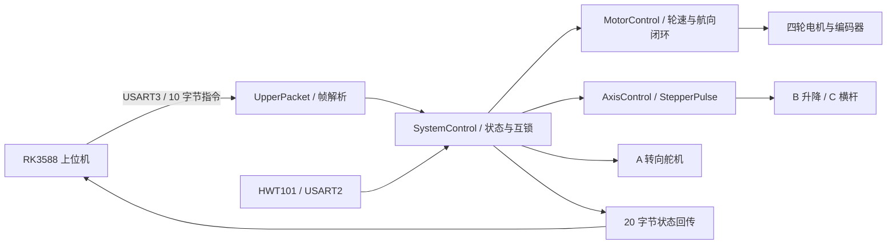

# 智能犊牛投喂系统 · STM32 执行端固件

本仓库是“基于视觉识别的智能犊牛投喂系统”的下位机工程：接收 RK3588 上位机发送的速度、航向和机构绝对位置目标，驱动四轮底盘、A 转向舵机及 B/C 步进机构，并回传执行状态与故障信息。

当前维护工程为 **[F407_HAL_Template](new_project_f407/F407_HAL_Template/README.md)**，目标器件为 **STM32F407VET6**，使用 STM32 HAL。旧 F103 工程保留在 Git 历史中。

## 系统分工

| 组成 | 职责 |
| --- | --- |
| 云端／管理端 | 场区、路线、投喂任务及设备管理，由配套工程实现 |
| [RK3588 边缘端](https://github.com/Muzhixing/calf-bucket-edge) | 视觉识别、双目测距、同桶追踪、靠桶与动作阶段编排 |
| **本仓库：STM32 执行端** | 指令解析、底盘和机构控制、执行互锁、传感器处理与状态回传 |

项目申报中的完整投喂方案还涉及视觉定位、路径执行和供液管理。当前固件聚焦运动与执行控制；水泵仅保留关闭初始化，定量供液不在当前运行链路中。

## 当前能力

| 模块 | 主分支实现 |
| --- | --- |
| 四轮底盘 | 麦克纳姆运动混合、四路编码器采样、10 ms 轮速 PID、方向反转制动与反馈故障检测 |
| 航向控制 | HWT101 数据解析、相对上电航向闭环、数据断续诊断与停机后的恢复确认 |
| A 转向 | 180° 舵机目标控制，上电参考为现场确认的 73 指令度 |
| B 升降／C 横杆 | 绝对位置目标、有限脉冲执行、步进位置累计及独立的软件零位确认 |
| 动作编排 | 底盘与步进轴互锁；当前主分支 B/C 按先升降、后横杆的顺序执行 |
| 上位机接口 | USART3 二进制控制帧、命令计数、结果码、状态及故障回传 |
| 超声波 | 距离采集和遥测，不参与自动避障 |
| 发布与验证 | Keil／GNU Arm 构建入口、主机桩测试、按版本归档的映像与 SHA256 记录 |

固件不承担图像识别、目标选择或完整投喂路线决策；这些由配套上位机组织。本文的功能说明以 `main` 源码为准，各候选分支按其自身记录验证。

## 运行结构



`User/main.c` 初始化外设，主循环依次执行 `HWT101_Poll`、`Bluetooth_Update`、`SystemControl_Update` 与 `MotorControl_Update`。外设驱动、协议解析和状态机通过已有模块协同。

## 硬件与工程环境

| 项目 | 当前配置 |
| --- | --- |
| MCU | STM32F407VET6，Cortex-M4，512 KiB Flash、128 KiB 普通 SRAM |
| 时钟 | HSE 8 MHz，SYSCLK 168 MHz |
| 上位机通信 | USART3，PC10 TX／PC11 RX，115200、8N1 |
| 航向输入 | HWT101，USART2 RX／PA3，115200、8N1 |
| Keil 工程 | `MDK-ARM/F407_HAL_Template.uvprojx`，目标 `F407_HAL_Template` |
| 已记录工具链 | ARMCC 5.06 update 5 build 528，Keil.STM32F4xx_DFP 2.17.1；或 GNU Arm 10.3.1 |
| 调试／下载 | ST-Link，SWD，Flash 起始地址 `0x08000000` |

完整引脚分配、驱动接口和电气约束见[接线文档](new_project_f407/F407_HAL_Template/docs/wiring.md)及[硬件资料](new_project_f407/F407_HAL_Template/docs/hardware/README.md)。

接线核对以网络名、当前源码及现场记录共同确认。编码器实测轮位与早期源码轮位命名存在差异，具体对应关系保留在接线文档中。当前 B/C 使用 STEP／DIR 脉冲接口，固件不初始化 CAN。

## 上位机通信

### 下行控制

控制帧为原有 10 字节二进制格式：

```text
B3 VX VY ANG SERVO LIFT SLIDE SW1 SW2 B4
```

| 字段 | 语义 |
| --- | --- |
| `VX / VY` | 有符号速度目标比例，范围 −100～100；前进／左移为正 |
| `ANG` | 相对上电稳定航向，每格 2°；采用最短角差 |
| `SERVO` | A 舵机指令角度 |
| `LIFT / SLIDE` | B/C 绝对位置，整数 mm；软件范围 0～175 mm |
| `SW1` | 预留，当前忽略 |
| `SW2` | bit0 使能；bit1／bit2 分别确认 B／C 软件零点 |

每帧包含完整目标，未操作的机构也需要填写其应保持的位置。速度百分比是目标比例，当前电机输出上限为 30% PWM。

### 上行状态

状态帧为 `B5 … B6` 共 20 字节，包含协议版本、合法格式命令计数、接受／拒绝结果、运行状态、使能与零点标志、B/C 脉冲估计位置、航向、超声距离、A 软件角度以及故障码；偏移 18 为偏移 1～17 的逐字节异或。

上位机应联合判断命令计数、结果和状态，不把“收到一帧”当作动作已完成。完整字段、帧解析规则与测试包见[协议文档](new_project_f407/F407_HAL_Template/docs/protocol.md)。

## 启动与执行边界

- **上电状态**：底盘与步进默认禁用，A 默认 73 指令度，水泵保持关闭；HWT101 稳定后建立航向参考。
- **零点登记**：B/C 坐标以已确认的机械起点为前提。登记只清软件累计值，不执行机械寻零；驱动器回零约定与 RK3588 的等待、单次登记策略见[启动零位说明](new_project_f407/F407_HAL_Template/docs/startup-zero-20261123.md)。
- **位置含义**：步进坐标由已发脉冲累计，不能检测丢步或外力位移；A 回传为软件指令角度。
- **停车方式**：使用原协议禁用命令，并检查禁用状态。当前没有无报文超时自动停车；上位机需管理停止请求及确认。
- **航向恢复**：数据重新有效后仍保持停用，经过新的禁用确认与显式使能后才能继续；原航向参考保持不变。
- **执行互锁**：轴／底盘及方向切换遵循状态机的等待条件。停脉冲不等于切断步进驱动器的保持电流。

状态码及行为：

| 状态 | 含义 |
| --- | --- |
| 0 | 禁用 |
| 1 | 就绪／航向保持 |
| 2 | 步进轴运动 |
| 3 | 底盘运动 |
| 4 | 故障 |
| 5 | 等待停车／切换 |

故障恢复、动作顺序与保护细节见[状态机](new_project_f407/F407_HAL_Template/docs/state-machine.md)和[航向恢复与诊断](new_project_f407/F407_HAL_Template/docs/heading-recovery.md)。

## 构建与主机检查

### Keil

1. 在 Keil 5 中打开 `new_project_f407/F407_HAL_Template/MDK-ARM/F407_HAL_Template.uvprojx`。
2. 选择 `F407_HAL_Template` 目标，核对 ARMCC5 和器件包配置。
3. 执行 Rebuild；常规 HEX 输出在工程的 `MDK-ARM/Objects/` 下。

具体时钟、链接布局和下载算法配置见[工程说明](new_project_f407/F407_HAL_Template/README.md)。切换工具链或器件包后需重新建立构建与验证记录。

### GNU Arm

从仓库根目录运行，显式提供包含 `arm-none-eabi-gcc` 的工具链目录：

```sh
python3 new_project_f407/F407_HAL_Template/tools/build.py \
  --source new_project_f407/F407_HAL_Template \
  --out build/f407-candidate \
  --toolchain /path/to/toolchain/bin \
  --name f407_candidate \
  --baseline "$(git rev-parse HEAD)"
```

构建工具从 Keil 工程读取 C 源文件列表和向量表，输出 BIN、HEX、匹配 ELF／MAP、启动文件、链接脚本及构建清单。该命令只构建，不烧录。

### 主机回归

需要 Python 3 和主机 C 编译器，从仓库根目录运行：

```sh
python3 new_project_f407/F407_HAL_Template/tests/run.py
```

测试在临时目录编译生产模块及硬件桩，覆盖帧解析、零点登记、绝对目标、轴／底盘互锁、禁用、故障回传、航向恢复和真实接收解析路径。可通过 `CC` 选择主机编译器，支持时可设置 `SANITIZE=1` 开启地址与未定义行为检查。测试不访问真实 MCU。

## 固件文件与验证记录

主分支保留的 A73 发布资料位于 [20261123-a73-startup](new_project_f407/F407_HAL_Template/firmware/20261123-a73-startup/README.md)，包含 BIN／HEX、匹配 ELF／MAP、构建清单及 SHA256 校验。其记录包括烧录读回比对、A73 复位回正和配套上位机软件零点登记。

四轮滤波资料位于 [20261123-all-encoder-filter](new_project_f407/F407_HAL_Template/firmware/20261123-all-encoder-filter/README.md)：四路输入滤波从 6 调整为 15，记录中的验收为四轮悬空、8% 速度目标、正反向各 120 秒。

上述内容是对应版本与条件下的历史验收记录。重新构建的映像是新候选，应先核对目标硬件、源码基线、工具链和文件摘要，再依据[复测步骤](new_project_f407/F407_HAL_Template/docs/test-guide.md)验证。`firmware/` 根部另有旧 Keil HEX，版本用途见[发布索引](new_project_f407/F407_HAL_Template/firmware/README.md)。

## 仓库结构

```text
README.md
new_project_f407/F407_HAL_Template/
  User/          主循环、时钟、中断与 HAL 配置
  Hardware/      状态机、协议与外设驱动
  Drivers/       STM32 HAL / CMSIS 及原始许可文件
  MDK-ARM/       Keil 工程、启动汇编与调试配置
  tools/         GNU Arm 构建入口
  tests/         主机回归与硬件桩
  docs/          接线、协议、状态机和历史验证资料
  firmware/      按版本保存的映像、调试符号与校验记录
```

## 文档导航

| 文档 | 内容 |
| --- | --- |
| [工程入口](new_project_f407/F407_HAL_Template/README.md) | 时钟、工程配置、依赖与基本使用 |
| [接线与资源](new_project_f407/F407_HAL_Template/docs/wiring.md) | GPIO、定时器、驱动与传感器连接 |
| [二进制协议](new_project_f407/F407_HAL_Template/docs/protocol.md) | 控制／状态帧、字段与确认语义 |
| [状态机](new_project_f407/F407_HAL_Template/docs/state-machine.md) | 动作优先级、互锁和故障处理 |
| [逐项测试](new_project_f407/F407_HAL_Template/docs/test-history.md) | 各模块测试条件与结果 |
| [复测指南](new_project_f407/F407_HAL_Template/docs/test-guide.md) | 现场验证步骤 |
| [航向恢复](new_project_f407/F407_HAL_Template/docs/heading-recovery.md) | 数据恢复、重新使能与内存诊断 |
| [A73 启动修复](new_project_f407/F407_HAL_Template/docs/startup-zero-20261123.md) | 校准、零点准备及配套验收 |
| [发布文件](new_project_f407/F407_HAL_Template/firmware/README.md) | 固件映像、历史版本与摘要 |
| [原理图与硬件](new_project_f407/F407_HAL_Template/docs/hardware/README.md) | 保留的原理图、PCB 与硬件资料 |

第三方 HAL／CMSIS 的许可文件随 `Drivers/` 一起保留。
